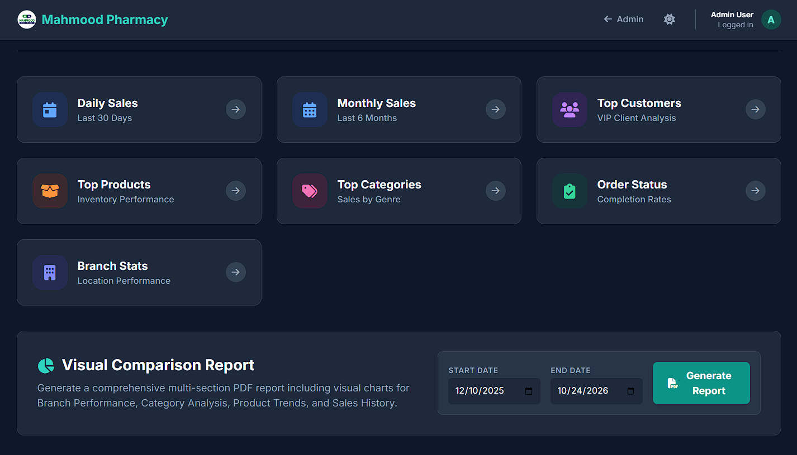
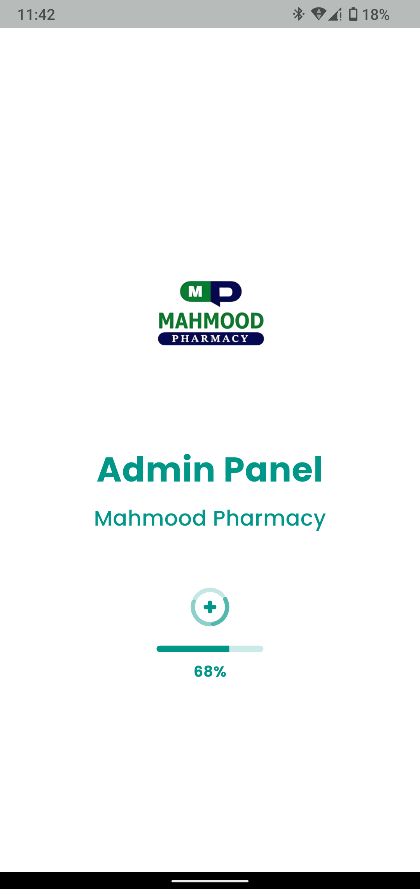
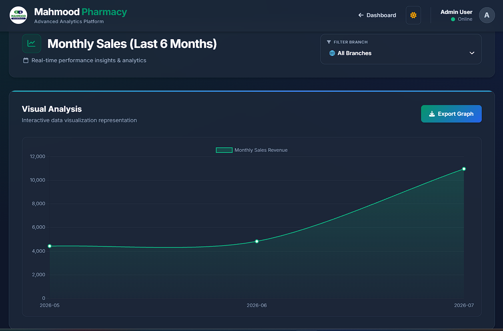
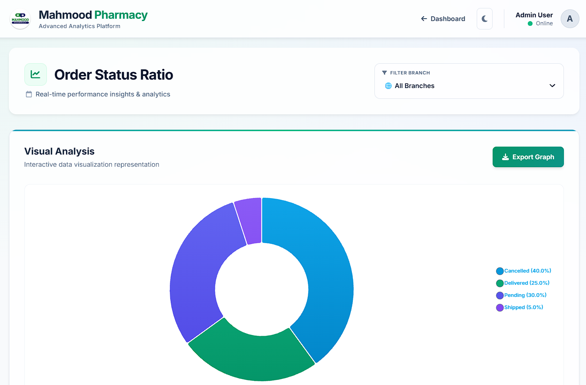
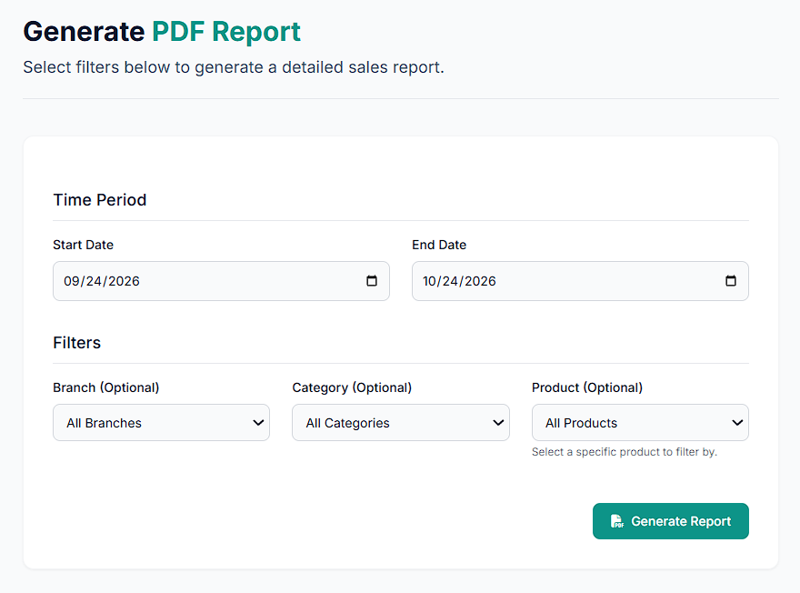
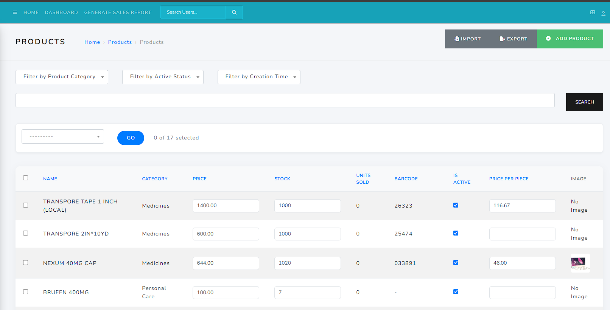

# Mahmood Pharmacy · Admin panel app

A Flutter Android shell for the hosted Mahmood Pharmacy Django admin. It gives staff a mobile-friendly entry point to catalog management, analytics, and PDF reporting while handling WebView file input and downloads.

**Flutter · Dart · InAppWebView · Dio · Connectivity Plus**

[Backend](https://github.com/Imranxhah/MAHMOOD_PHARMACY_BACKEND) · [Customer app](https://github.com/Imranxhah/MAHMOOD_PHARMACY_CUSTOMER_APP)

## Interface

| Mobile startup | Monthly sales |
| --- | --- |
|  |  |

| Order status | Report builder |
| --- | --- |
|  |  |

| Product management |
| --- |
|  |

The admin also exposes a [visual comparison report workflow](docs/screenshots/visual-report.png). Screens containing personal email addresses were intentionally excluded.

## What the Flutter shell handles

- Loads the hosted Django admin in an in-app WebView.
- Shows offline and page-error states and supports pull-to-refresh.
- Routes Android back actions through WebView history.
- Bridges HTML file inputs to the native image picker and restores interrupted picks.
- Handles normal downloads plus Blob/Base64 PDF report downloads.
- Displays progress while reports and files are being generated or saved.

## Get started

Use Flutter 3.35 or newer to match the Dart 3.9 constraint.

```bash
git clone https://github.com/Imranxhah/MAHMOOD_PHARMACY_ADMIN_PANEL.git
cd MAHMOOD_PHARMACY_ADMIN_PANEL
flutter pub get
flutter run
```

The hosted admin URL is currently defined directly in [lib/screens/admin_webview_screen.dart](lib/screens/admin_webview_screen.dart). Change `_initialUrl` before running against another environment.

## Project structure

| Location | Responsibility |
| --- | --- |
| [lib/main.dart](lib/main.dart) | App startup, Android permissions, and Material theme |
| [lib/screens/admin_webview_screen.dart](lib/screens/admin_webview_screen.dart) | WebView lifecycle, file picker bridge, downloads, and report handling |
| [lib/common_widgets/pharmacy_loader.dart](lib/common_widgets/pharmacy_loader.dart) | Branded page-loading state |
| [lib/common_widgets/report_generation_loader.dart](lib/common_widgets/report_generation_loader.dart) | Report generation feedback |

## Deployment notes

- The app depends on the hosted admin being reachable and compatible with its injected JavaScript handlers.
- Review Android media and storage permissions against the minimum supported Android version before release.
- Replace the default `com.example...` application ID and configure release signing before publishing.
- Use a trusted HTTPS admin origin because the WebView handles authenticated staff workflows.

No license file is included. Contact the owner to clarify reuse terms.

Built by [Imran Shah](https://github.com/Imranxhah).
